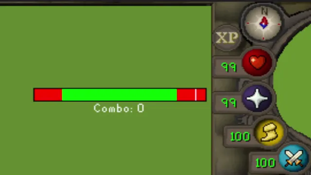

# 1 Tick Flick
Visual tick bar and combo counter for 1-tick prayer flicking with the quick prayer orb

## What is 1-tick flicking?
1-tick flicking is a method of prayer flicking that involves deactivating and reactivating your prayers on every single game tick.  
This allows you to use both offensive and defensive prayers at the same time, while using no prayer points.

To 1-tick flick, start with your prayers enabled, then every tick deactivate and reactivate your prayers.

## Do I have to be within the green zone?
No, the green bar is just an adjustable target zone to help practice more precise timing and reduce the chance your clicks land outside the 1‑tick window.    
If you don't care about this, you can set the start to 0ms and the end to 600ms.

## Config Options
- Resizable overlay - Hold the `alt` key and drag the edges of the overlay
- Enable/disable the overhead prayer bar - similar to the RuneLite "Prayer" plugin prayer bar
- Enable/disable the overlay prayer bar
- Enable/disable the combo counter
- Enable/disable detection of prayer book clicks
- Set a click delay to account for latency or server delay
- Set the green bar start and end to adjust the target zone in the overlay prayer bar
- Adjust the width of the swipe line in the overlay prayer bar
- Customize the combo counter text
- Set a timeout for the overhead prayer bar / overlay to hide after a certain amount of time when not clicking prayers
- Enable/disable timeout while prayers are active
- Recolor all the overhead prayer bar elements
- Recolor all the overlay elements
